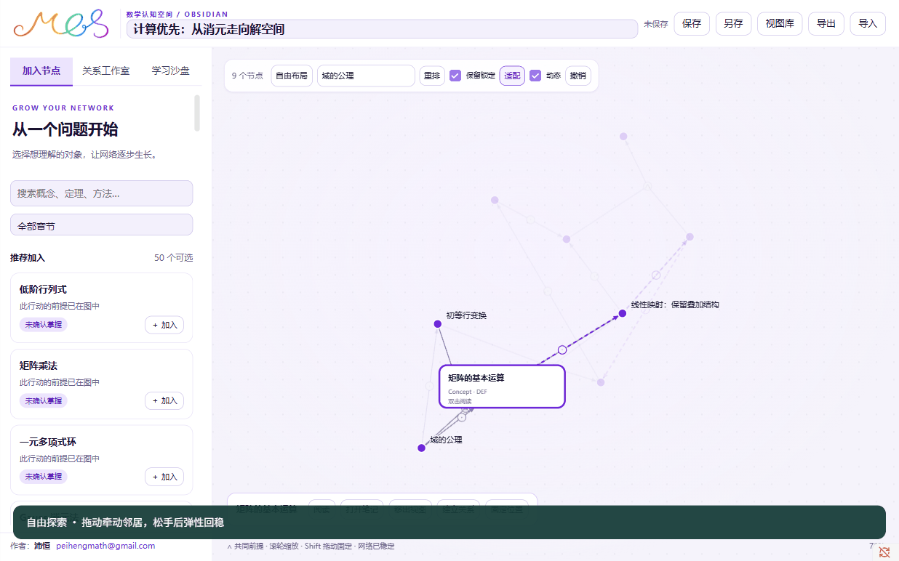

# 0.2.0 动态关系视图

为了让图成为可以思考的空间，加入一个对象应当让邻居自然让位，拖动应当保留空间联系。为了准确阅读推导，回放又需要稳定位置，看清同一个事件的全部条件。两条动机形成不同运行方式：自由探索使用弹性模拟；规则布局与学习回放使用稳定坐标。

## 操作

| 操作 | 结果 |
| --- | --- |
| 搜索／推荐中加入 | 从已关联对象附近出现；无关联对象从当前视野加入 |
| 自由布局拖动并松手 | 邻居被牵动，网络逐渐回稳，不自动固定 |
| Shift 拖动／“固定位置” | 位置固定；“解除固定”恢复弹性参与 |
| 悬停或键盘聚焦 | 当前对象及直接关系整体突出，联合前提保留 ∧ |
| 单击／空格 | 选中对象，工具条提供阅读、笔记和关系入口 |
| 双击／Enter | 阅读完整节点笔记 |
| Delete | 移出视图，可撤销；笔记保留 |
| 空白拖动／滚轮 | 平移／以光标为中心缩放 |
| 画布聚焦后方向键、＋、－ | 平移、缩放；Shift 方向键加大移动距离 |
| 自由／逻辑核心／学习顺序 | 自由模式弹性运动；另两种平滑到规则位置后静止 |
| “动态”开关 | 控制自由布局运动；系统减少动态效果也会停用移动动画 |
| 窄窗“面板”开关 | 侧栏自动收起，按需展开，给画布保留空间 |

远景以圆点与避让标签表示网络。缩放到 110% 展开卡片，降到 85% 以下再恢复圆点；中间区间保留当前外观，避免闪烁。选中或聚焦对象始终显示完整名称，节点中心不因外观切换而变化。卡片显示类型、当前可用的检查状态及掌握／固定标记。

关系的线型、颜色和详情来自证据状态。距离与运动是阅读辅助，不给证明或掌握程度评分。

本轮保留 SVG 的节点、可编辑形式关系和键盘入口，为教材联合行动增加共享 GPU 绘制层，按相同坐标显示全部输入、∧ 汇合与输出箭头。这是针对实际宿主性能采样做出的实现调整：避免大量 SVG 关系图元每帧重新计算样式及栅格化。没有 GPU 上下文时使用二维 Canvas 回退；本轮性能验收只覆盖实测的 WebGL 环境。

## 学习演绎

计算与结构两份案例预先保存整条路线的坐标。播放依次突出实际前提、联合行动、产出；删去沙盘背景后标出失败来源。暂停冻结当前阶段，跳步直接显示完整目标帧，减少动态效果使用即时状态变化。学习回放中不能拖动节点，播放不改变真实掌握记录。

## 保存与升级

运行坐标和速度属于模拟副本，公共内容不随动画改变。拖动、缩放和布局切换分别形成操作快照，不为每一帧创建撤销记录。收敛后提交坐标；保存、导出和关闭先停止运动，提交当前画面。重新打开停在保存位置，等待下一次操作再开始模拟。后台 Obsidian 标签页及不可见文档暂停帧循环。

新文件使用 `mcs-view/2`，新便携包使用 `mcs-bundle/2`。第一版视图与包可以读取，保留原坐标、锁定点、关系和路线，补齐动态设置。首次写入旧视图前在 `MCS-workspace/旧版备份/` 留下逐字副本。并发保存沿用修订号检查和独立恢复文件。

笔记右键菜单“在 MCS 中展开”或同名命令优先使用已有绑定，再读取 `mcs-node-id`。无法定位时显示节点选择器，由学习者选择；不会凭标题猜测数学对象。

## 动态演示与验证

演示由隔离测试库中的实际界面录制，包含弹性拖动、缩放外观和学习回放。三份第二版便携案例位于 `examples/`。有限场景的检查入口、机器可读记录与性能实测见 [验收记录](VALIDATION.md)，未覆盖的平台与数学检查范围也在其中说明。

回看：同一对象靠近另一个对象，究竟是排布选择还是有据可查的关系？沙盘中前提可用，是否意味着自己已经掌握？

思想：自由探索允许空间生长，严格演绎保持条件和位置稳定。方法：弹性组网用于提出联系，证据详情用于检查联系，稳定回放用于看清实际推导。
