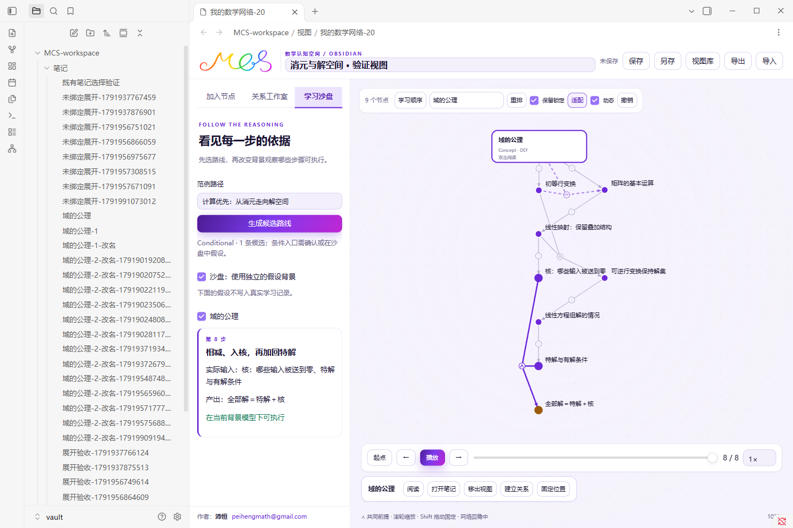
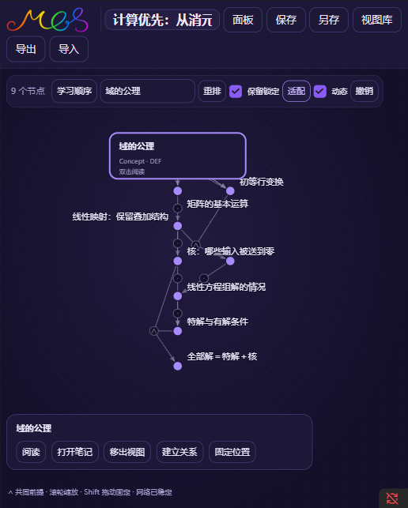

# 桌面试用验收记录

日期：2026-10-15。版本：0.3.0。以下结果是 FINITE，指当前构建、给定输入和本机环境的检查；不构成一般性能、教学收益或完整数学正确性的证明。

## 已检查的范围

| 入口 | 结果 | 具体范围 |
| --- | --- | --- |
| `npm run check` | 通过 | TypeScript 类型检查 |
| `npm run build` | 通过 | 插件、独立 ND 工作进程、Python 内核、Lean 入口与本地图片资源打包 |
| `npm test` | 32 项通过 | 联合输入与备选生产者、实际前提、空背景、复习事件、路线来源、版本哈希、学习记录隔离、网站迁移、布局锁定、证据失效、推荐、两条案例路线、类型错误及真实 ND 证书重放；第一版迁移、运动层副本、收敛、小数锁定坐标、弹性拖动和外观回差；新增定义来源、循环／歧义／版本、精确全称代入、有限实例／反模型、完整表、真假条件、二元运算／量词、独立重放篡改与便携复用 |
| `node scripts/browser-check.mjs` | 16 个桌面流程通过 | 实际 Obsidian 加载、空闲后的首次保存、多次保存、联合关系编辑、独立 ND 检查、8 事件沙盘、前提缺失传播、个人记录隔离、重开、便携导入、节点版本隔离、笔记创建与改名、既有笔记选择、并发保存与恢复副本；固定 Lean 目标另见下项 |
| `node scripts/restart-check.mjs` | 通过 | 关闭并真正重新启动独立 Obsidian 进程（渲染进程 PID 变化）；重启后读到的插件清单版本是 0.3.0；正常文件和恢复副本均可重新打开 |
| `node scripts/dynamic-check.mjs` | 24 个流程通过 | 外观回差、联合聚焦、弹性拖动、精确固定、一次操作撤销、动画期间保存／导出／关闭、后台暂停、减少动态效果、稳定回放、旧文件逐字备份、笔记命令与右键、GPU 上下文恢复、窄窗深色与键盘入口；**新增**：明暗切换后画布配色整份刷新（中性线与失败色与 CSS 变量逐字一致） |
| `node scripts/renderer-check.mjs` | 通过（24.3ms） | 200 节点、600 条不同联合行动，持续真实指针拖动和滚轮缩放；收敛后停止持续绘制；示范链适配避开工具栏与播放控件。取「宿主帧间隔」与「图重绘间隔」的较差者；该规模上逐帧重绘，两者可比 |
| `node scripts/theme-check.mjs` | 12 项通过，5 个视口 | 主题、品牌与无障碍；见下节 |
| `node scripts/host-baseline.mjs` | 环境地板 6.2ms | 无视图／空视图／静止／只拖动／拖动+滚轮，五种状态下宿主帧间隔 p95 都是 6.2ms，说明瓶颈不在机器 |
| `node scripts/perf-check.mjs` | 20 次测量通过，0 次受干扰 | 两条绘制路径 × 五个规模 × 两次重复；两条事先写明的门槛达标，二维回退在合成压力规模超线如实记录 |
| `node scripts/soak-check.mjs` | 通过 | 连开连关 8 次 + 持续拖动 2 分钟；工作集增长、p95 随时间退化与页面异常都在门槛内 |
| `node scripts/compat-check.mjs` | 通过（静态） | `minAppVersion: 1.7.2` 与类型定义逐个比对；不能替代 1.7.2 宿主上的实机运行 |
| `node scripts/record-demo.mjs` | 实际界面录制 | 弹性拖动、圆点／卡片缩放及学习回放，截图编码为动画 |
| `node scripts/witness-check.mjs` | 12 个桌面流程通过 | 旧第二版文件逐字备份、定义来源编辑、精确代入、有限实例、反模型、自然见证无侧栏溢出、保存、来源编辑后过期、假输入拒绝、重开、实际便携文件导入、窄窗与 Escape |
| `node scripts/check-lean.mjs` 与插件入口 | 3 个固定目标通过 | 编译、实际环境目标核对、公理收集、独立 `leanchecker` 重放 |

机器可读的桌面记录、构建文件摘要和性能实测见 [validation/desktop.json](validation/desktop.json)，形式目标及源文件摘要见 [validation/lean.json](validation/lean.json)。安装包的 `CHECKSUMS.json` 另列打包文件和 ZIP 的 SHA-256。

## 主题、品牌与无障碍（0.2.1 新增）

`node scripts/theme-check.mjs` 在独立测试库上按浅色 1440×960 / 深色 1440×960 / 浅色 1000×820 / 深色 860×720 / 浅色 700×760，以及窄窗 520×760 逐一取样。12 项检查分别是：

1. **打包样式不外泄**：`dist/styles.css` 的 252 条选择器全部带 `mcs-` 前缀；42 个 `--mcs-*` 令牌没有一个声明在 `:root`、`html`、`body` 或 `*` 这类全局作用域上。
2. **字标与署名（5 个视口）**：顶栏字标 `naturalWidth > 0`（确实加载，不是坏图），渲染宽高比与原图比例相差 < 2%；工作面板底部同时出现「作者：沛恒」与 `mailto:peihengmath@gmail.com` 链接，文字与 `href` 逐字核对；署名容器允许换行且不溢出（`scrollWidth - clientWidth ≤ 1`）。
3. **无重叠**：工具栏、署名、阅读面板、播放控件、选择条、画布底注两两求交，任何一对的重叠面积都必须为 0。阅读面板在窄窗按实测的工具栏下沿与底部浮层高度收缩，因此不会盖住播放控件。
4. **对比度 ≥ 4.5:1**：先做令牌矩阵（正文／次级正文／弱化文字／主色／主色深／成功／待办／失败 对 各底色），再对真实渲染出来的元素取样实测；只有字号 ≥ 24px（或 ≥ 18.66px 且加粗）才按大字号 3:1 判定。两种主题都通过。
5. **窄窗抽屉**：面板打开时署名在 520 px 宽下换行、邮箱不被裁切，`flex-wrap` 生效。
6. **面板收起后的落点**：收起工作面板后，插件设置页（Obsidian 会为设置另开窗口）仍显示紫色徽记（原比例）、完整署名与版本号（脚本从 `manifest.json` 读，不写死），且令牌没有泄漏到该窗口的 `body` 或普通笔记元素上。
7. **空白引导徽记**：浅色与深色都显示紫色徽记且保持原比例。
8. **画布配色刷新**：切换主题后 `data-palette` 必然改变，且其中的中性线与失败色与 `--mcs-neutral` / `--mcs-failure` 的计算值逐字相同；实测路径为 WebGL。
9. **二维回退同源**：临时让行动画布取不到 WebGL 上下文并重开视图，`data-renderer` 转为 `canvas`，配色键、令牌矩阵与文字对比度在回退分支上同样通过——SVG、Canvas 与 WebGL 三条路径确实共用一套令牌。
10. **键盘焦点**：用真实 Tab 键移动焦点（程序化 `focus()` 不触发 `:focus-visible`），焦点圈颜色等于主色、宽度 ≥ 2px；画布仍在 Tab 顺序内（`tabIndex = 0`），方向键仍能平移相机。
11. **减少动态效果**：`prefers-reduced-motion: reduce` 下重排不播放动画，画布保持 `data-motion="idle"`。
12. **设置页与作用域**：见第 6 项，令牌与署名都在插件自己的作用域内。

截图：[浅色工作台](theme-light.png)、[深色工作台](theme-dark.png)、[窄窗深色](theme-narrow.png)、[插件设置页](theme-settings.png)、[空白引导·浅色](theme-empty-light.png)、[空白引导·深色](theme-empty-dark.png)。

## 环境与复现

Windows 桌面，实际 Obsidian 1.14.4，安装程序 1.9.14，Electron 37.6.0。在插件自己的 `runtime/obsidian-*` 下创建测试库和独立配置，使用独立调试端口。用户原有 Obsidian 配置与笔记库不用于测试。版本从宿主的“关于”页面读取；开发依赖的类型包版本不能替代这个记录。尚未覆盖其他桌面平台、移动端或所有支持版本。



[20 秒动态操作演示](dynamic-demo.gif)包含弹性拖动、缩放外观与学习回放，来自实际隔离测试库。



```powershell
cd E:\MCS\mcs-obsidian
npm ci
npm run check
npm run build
npm test
npm run examples
node scripts/start-test-vault.mjs
node scripts/browser-check.mjs --lean
node scripts/restart-check.mjs
node scripts/dynamic-check.mjs
node scripts/witness-check.mjs
node scripts/renderer-check.mjs
node scripts/theme-check.mjs
node scripts/record-demo.mjs
node scripts/start-perf-vault.mjs                 # 性能验收专用实例（独立库/配置/端口）
node scripts/host-baseline.mjs --session=runtime/perf-session.json
node scripts/perf-check.mjs  --session=runtime/perf-session.json
node scripts/soak-check.mjs  --session=runtime/perf-session.json
node scripts/compat-check.mjs
node scripts/record-validation.mjs
npm run package
npm run verify:package
```

本机若 Go 类型检查器因提交内存不足退出，可在当前 PowerShell 会话设置 `$env:GOMEMLIMIT="128MiB"` 与 `$env:GOGC="20"` 后重试；不会修改系统配置。

首次独立测试库可能需要在其窗口确认启用本地测试插件。Lean 流程需要 README 中指定的原生工具链和已准备的 mathlib 缓存；普通桌面流程可省去 `--lean`。脚本只测试它记录的独立库，不能拿任意个人库路径代替。

发布版本只在 `manifest.json` 里写一次：桌面、动态、渲染、主题、演示与汇总脚本都从 `scripts/manifest.mjs` 读取，安装包校验 `scripts/verify-package.py` 也改成与清单比对，脚本里不再写死版本号。

## 内容快照与局部作者登记

0.3.0 沿用 0.2.1 的 `85f317bf…` 内容快照，没有改写公共教材内容。0.2.1 相对 0.2.0 的 `02ac2ce6…` 变化来自当时上游来源摘要修订。旧视图仍按各自绑定的不可变快照打开。

本轮在 `mcs-view/2` 中新增局部 `formalSources`，关系在 `formal.witness` 中保存专用见证；三份 `mcs-bundle/2` 案例都补上四条待核验练习。旧视图补空来源登记，速度和可信检查报告不入文件，真实掌握仍单独保存。带此新增字段的视图需要 0.3.0，0.2.x 不认识这个字段。没有把来源登记修改当作公共本体改版。

## 专用见证的实测边界

[编辑与使用说明](FORMAL-WITNESSES.md)区分 DEF 来源登记、ND 条件模式和 FINITE 满足／反模型。源码复用现有解析、类型、代入和有限求值模块；独立 Python 重放类型与闭项定义、检查循环或重新枚举有限表，并比对精确输入摘要与结果。

[定义来源编辑器](formal-source-editor.png)、[有限反模型核验](formal-witness-view.png)来自实际隔离 Obsidian。检查报告驻留当前窗口，改见证或来源就过期，重新打开与导入不会继承“本机通过”。运行错误与预算超限不报告为数学反驳。

有限模型仅支持一个 1–8 元素载体、最多 32 个符号、一元／二元闭运算和有界一阶公式。没有实现多载体或高阶有限语义；局部背景签名的数学解释、一般类型理论与教材对应不由这些表自动保证。32 项核心测试中的 11 项专用测试包含真实 Python 子进程与负例，测试不是检查器的形式化可靠性证明。

## 动态视图的实测边界

节点、可编辑形式关系、可访问名称和键盘入口保留 SVG。教材联合行动使用共享 WebGL 绘制层，完整保留各条输入、∧ 汇合和输出箭头；没有 GPU 上下文时使用二维 Canvas 回退，两条路径读同一份令牌。**二维回退的性能与两条路径的规模走向见下一节**（本轮已补测）。关闭视图主动释放绘制资源；已检查上下文丢失后恢复。这个实现调整来自实际 SVG 大图性能采样，绘制层不能修改内容、证据或真实掌握记录。

实测环境：11th Gen Intel(R) Core(TM) i7-11370H @ 3.30GHz、15.7 GiB 内存、Obsidian 1.14.4／Electron 37.6.0，视窗 1440×960。`renderer-check` 的 200 节点／600 条不同联合行动，第 95 百分位 **24.3ms ≤ 33ms**；该脚本取「宿主帧间隔」与「图重绘间隔」的较差者，在这个规模上图确实逐帧重绘，所以两者可比（下一节说明什么时候不可比）。详细帧统计见机器可读记录；收敛后没有持续绘制循环。

## 性能与稳定性（本轮新增实测）

判据与做法都写在脚本头部，这里只记结论。三条独立的记录：`validation/perf.json`（两条绘制路径 × 五个规模 × 每个规模两次重复）、`validation/soak.json`（反复开关视图 + 持续操作）、`runtime/host-baseline.json`（环境地板）。

**为什么要用专用实例**：`scripts/start-perf-vault.mjs` 另起一套库、配置与调试端口（`runtime/perf-session.json`）。同库同实例上只要还有别的脚本在开关视图，第 95 百分位测的就是两边互相干扰的结果。每次测量前后还各取一次**外部**进程（排除本实例进程树与 node）的 CPU 累计时间，换算出这段窗口别人占了几核；占用高于 30% 的记作 contended 不参与判定。20 次测量全部未越线，外部负载 1–3%（同机早先有约 20% 外部负载时，同一规模的 p95 会高出 15–25%，所以这一列必须记）。

**环境地板**：`node scripts/host-baseline.mjs` 在「无视图／空视图／静止小图／只拖动／拖动+滚轮」五种状态下采样宿主帧间隔，第 95 百分位都是 **6.2ms**（约 165fps）。说明这台机器与合成器本身不是瓶颈，下面的数字是插件加上去的部分。合成器的节拍会随窗口是否被遮挡而在约 165fps 与约 130fps 之间变化，跨次测量时绝对毫秒数会有 1–2ms 的浮动，两次都远低于门槛。

**两条路径 × 五个规模**（取两次重复里较好的一次，均为未受干扰的测量；外部负载 1–6%）：

| 规模 | 节点／联合行动 | 画出的边 | WebGL 帧间隔 p95 | WebGL 平均帧率 | 二维回退帧间隔 p95 | 二维回退平均帧率 |
| --- | --- | --- | --- | --- | --- | --- |
| 计算示范路线（真实） | 9／60 | 11 | **8.3ms** | 129.2 | **8.3ms** | 129.9 |
| 全书地图（真实内容上限） | 59／60 | 60 | **8.3ms** | 118.6 | **8.3ms** | 130.0 |
| 合成压力 · 小 | 50／100 | 100 | **8.2ms** | 130.8 | **8.2ms** | 130.5 |
| 合成压力 · 既有基线 | 200／600 | 600 | **15.8ms** | 98.0 | 39.4ms | 30.9 |
| 合成压力 · 大 | 400／900 | 900 | **23.5ms** | 57.3 | 53.6ms | 22.7 |

事先写明的两条门槛都满足：WebGL 在 200／600 为 15.8ms ≤ 33ms；两条路径在真实内容上限（59 节点）为 8.3ms ≤ 33ms。**没有满足、也不打算含糊过去的两处**：二维回退在 200／600 是 39.4ms、在 400／900 是 53.6ms，超过 33ms——它本来就是没有 WebGL 时的降级路径，本轮把数值如实记进 `missesFrameTarget`，并为它另外设了「真实内容上限 ≤ 33ms」这条能兑现的门槛。

**二维回退的正确性**：同一规模下两条路径画出的边数逐一对齐（11／60／100／600／900），不是「回退了就少画」。

**空闲与延迟**：20 次测量在收敛后都是 0 次额外重绘；图开着但不动作时渲染进程 CPU 占用 0.01–0.05%（20 次里有一次 1.16% 的尖峰，无视图基线同为 0.01–1.16% 量级）。插件重新加载 46ms；视图首次挂上节点 31–547ms（最短出现在小图，最长出现在 400 节点图的冷启动，第二次同规模降到 119ms）；主题切换 17.6–24.8ms（一次配色缓存重建加整帧重绘）。

**一处量具修正（会影响怎么读旧数字）**：帧延迟原先取「宿主帧间隔」与「图重绘间隔」的第 95 百分位中的较差者。图安静下来之后绘制层只在有输入事件或模拟步进时重画：小图一次拖动很快收敛，重绘次数跟着注入的指针事件走（约 35 次/秒），重绘间隔的 p95 就成了**输入节奏**（约 36ms），而同一时刻宿主帧间隔的 p95 只有 6.2ms。把两者取最大值会把「画得少」误判成「画得慢」。`perf-check` 因此把两个分量分开记录，只在绘制层确实逐帧重绘（重绘次数 ≥ 帧数 × 0.9）时才合并；上表用的就是宿主帧间隔。

**内存与稳定性**（`soak-check`）：同一张 200／600 的图连开连关 8 次，每次关闭后取常驻内存与 JS 堆——常驻内存 704.3 → 712.9 MB（**+8.6 MB**），JS 堆 −10 MB，视图全部关闭后比测试前高 61.7 MB（门槛 80 MB）。随后一口气持续真实拖动 2 分钟，按 30 秒分 4 桶统计帧间隔：p95 依次 16.2 / 16.1 / 16.2 / 16.3ms，末桶是首桶的 **1.01 倍**（门槛 1.5 倍），也就是两分钟里没有随时间退化。全程无页面异常、无渲染进程崩溃。这一桶的 16.2ms 与性能矩阵里同规模的 15.8ms 互相印证。数值见 `validation/soak.json`。

## 宿主版本兼容（静态核对）

`node scripts/compat-check.mjs` 对 `minAppVersion: 1.7.2` 做静态核对，结论记在 `validation/compat.json`：打包产物从 `obsidian` 模块只取 11 个符号（`Component`、`FileSystemAdapter`、`FileView`、`FuzzySuggestModal`、`MarkdownRenderer`、`Notice`、`Plugin`、`PluginSettingTab`、`Setting`、`TFile`、`normalizePath`），逐个查官方类型定义的 `@since`，没有晚于 1.7.2 的；清单也确实声明了 `isDesktopOnly`。另有 21 个「同名成员」候选（`title`、`status`、`value`、`addClass` 之类），逐个核对后都是自家字段，唯一需要实证的 `addClass` 调用的是 `HTMLElement` 增强成员——已直接读 `obsidian.d.ts` 确认那一处没有 `@since`。

**这只是静态结论**：类型定义只记录「从哪个版本开始有」，不覆盖行为差异与从未标注的改动。要真正确认 1.7.2，必须在那个版本的安装包上实机跑一遍。移动端不适用（`isDesktopOnly: true`）；macOS／Linux 未测，代码里非 Windows 分支只做了静态阅读。

## 数学与教学边界

本轮三个固定 Lean 目标已于 2026-10-15 在插件入口完成编译和独立重放。随后仅调整专用关系报告的展示、旧视图备份与 Python 缓存生成；Lean 目标和核验脚本未改，汇总入口再次比对其源文件哈希。最终构建的常规桌面回归为 16 项，早先包括 Lean 的集成回归为 17 项；不将前者写成再次执行了 Lean 编译。三个 Lean 目标是可逆线性映射的消去、特解加核、有限维秩—零度。其源文件哈希、实际目标与公理在独立审计中登记。教材对应仍为 `pending`；尚未覆盖三类具体初等矩阵的构造，也不支持任意用户 Lean 目标。

关系编辑器的 ND 检查限于已实现的条件推导、双向等价和指定放缩方向。搜索未找到证明时保留未决，不报告为假。Python 检查器自身尚未经过形式化验证。本轮补上定义引用、精确全称实例、有限满足／反模型的专用检查；任意用户 Lean 目标适配仍待实现。类比不作为证明。

地图有 59 个节点；其中完整示范正文为 10 个。未逐条校勘整本教材，其他地图入口不能当作完整学习笔记。动态系统目前演绎依赖事件与背景可用性，未实现几何对象动画。没有对学习成绩或长期记忆做用户研究。

回看：学习者是否能区分“当前精确陈述已检查”与“已准确表达教材”？配色与署名换过一轮之后，哪些教学效果或平台兼容性仍需另行检查？

思想：验收要固定输入身份，并允许读者复核结论边界。方法：分别记录桌面行为、主题与无障碍、数学目标和教材对应，使用文件摘要把记录绑定到具体成品。
